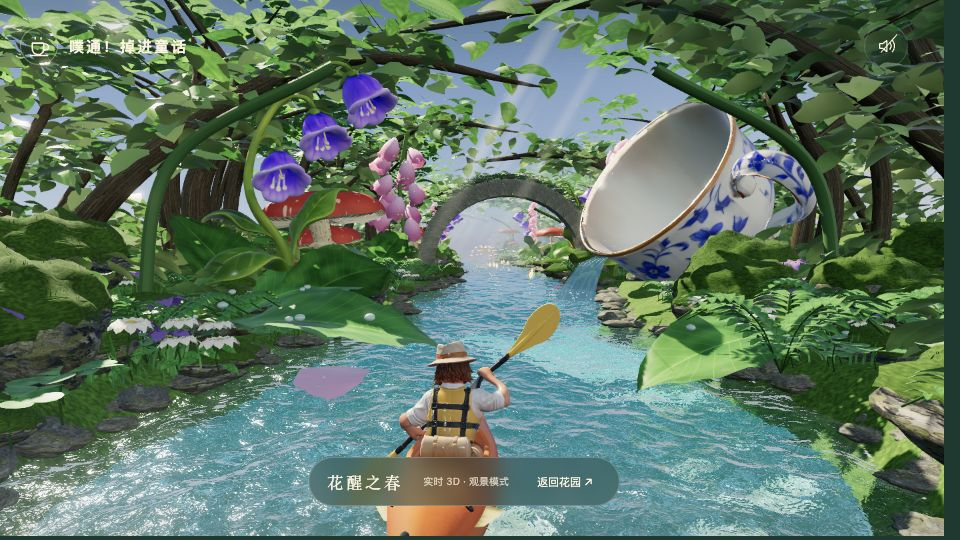
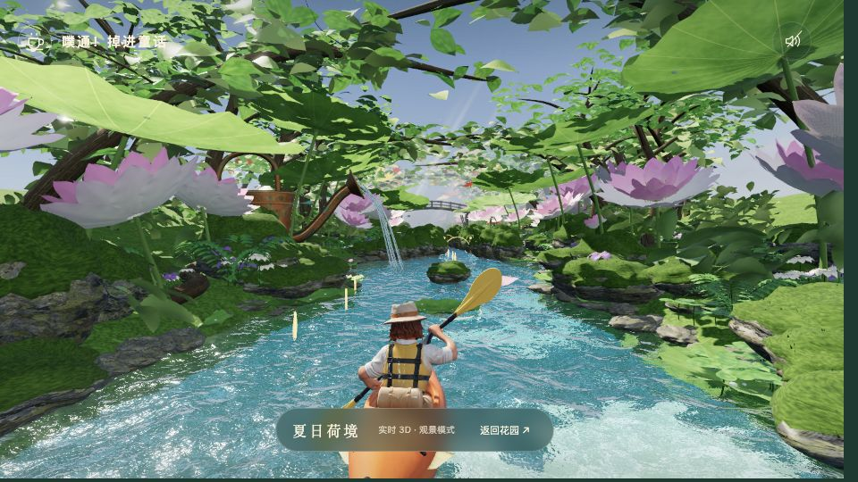
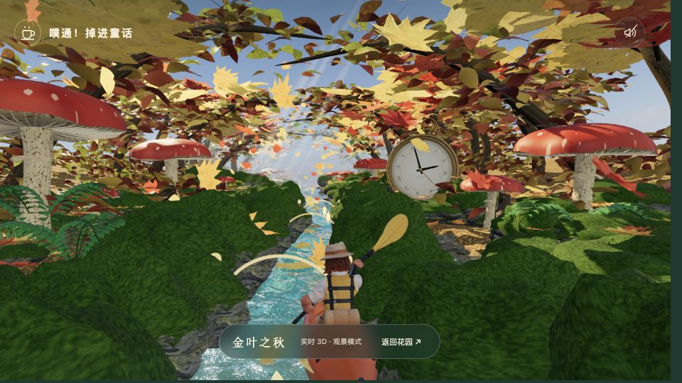
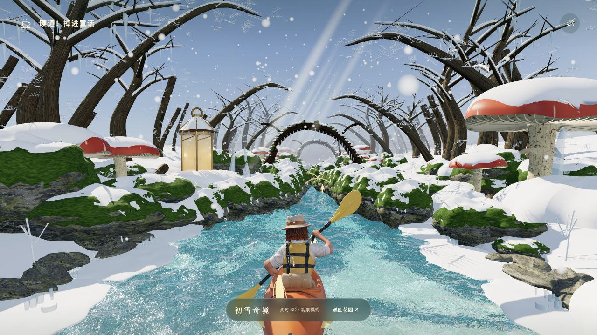

# 噗通！掉进童话

划着橙色小舟，穿越巨大花园里的春、夏、秋、冬。完整 Three.js 实时 3D 版本，面向 GitHub Pages 与桌面浏览器。

[在线游玩](https://zxl9456-hub.github.io/splash-into-fairyland/) · [部署状态](https://github.com/zxl9456-hub/splash-into-fairyland/actions)

本版从保留的高精度工程恢复，不采用小红书包里的简化角色、小贴图或 Canvas 2D 兼容画面。默认「极致」画质，可在菜单中切换「精致／均衡」。三个档位都使用完整模型。

## 开始游玩

选择船只，点击「出发」开始连续 1200 米航行；春夏秋冬之间有连续的地形、植被、天气、光线与音乐过渡。「试划这一季」用于体验选中的季节。「实机观景」提供四季 3D 景点，点击「返回花园」回到菜单。

- A / D 或方向键：左右划桨
- W：奋力加速；空格：减速
- E：星光反击；Q：船只技能
- P / Esc：暂停；手机使用屏幕按钮
- 轻羽艇跃浪、苔石艇护盾、月萤艇反击；所有船均为 3 条命
- 激流、坡降、跃浪、窄道、漂移、水门、恶龙、食人花、四季灾害、冬季倒木与四季纪念品均保留

声音需要主动点击右上角声音按钮开启。

## 本地运行

需要 Node.js 22 或以上。本项目无需安装 npm 依赖。

```sh
node scripts/serve.mjs
```

打开终端输出的地址（默认 `http://127.0.0.1:4202/`）。不要直接双击 HTML；模型和 ES Modules 需要通过 HTTP 加载。

```sh
node --test game/tests/*.test.mjs
node scripts/build.mjs
node scripts/verify.mjs
node scripts/serve.mjs dist
```

装有 npm 的标准 Node.js 环境也可使用 `npm test`、`npm run build`、`npm run verify`、`npm run preview`。

## GitHub Pages 部署

1. 把本文件所在目录的内容放到 GitHub 仓库根目录，保留隐藏目录 `.github`，使用 `main` 分支。
2. 在仓库 **Settings → Pages → Build and deployment → Source** 中选择 **GitHub Actions**。
3. 推送到 `main`，或在 **Actions → Deploy Fairyland to GitHub Pages → Run workflow** 手动运行。
4. 成功后在部署记录中打开实际生成的 Pages 链接。

工作流会先运行测试、构建和资源校验，再发布 `dist`。所有资源使用相对路径，支持 `https://用户名.github.io/仓库名/`。模型、贴图、音频和 Three.js 都在包内，不依赖第三方 CDN 或运行时 API 密钥。

参考：[GitHub Pages 官方自定义工作流说明](https://docs.github.com/en/pages/getting-started-with-github-pages/using-custom-workflows-with-github-pages)。

本仓库为 `zxl9456-hub/splash-into-fairyland`，Pages 使用 GitHub Actions 自动发布。更新 `main` 分支后，在 Actions 页面查看部署结果。

## 恢复的画质

- 划船角色和小艇：150,000 三角面，保留 `Paddle_Cycle` 骨骼动画
- 茶杯：60,000 三角面；风铃花：22,000；溪龙：101,500
- 原始 GLB 内嵌 PBR 贴图、完整树皮／苔石贴图、4K 天空环境
- Water Pro FFT 水面、屏幕空间反射、折射、焦散、岸边泡沫及船尾波
- 默认 4096 阴影、最高 2 倍像素比例、柔和 Bloom
- 叶片／花瓣透光、细化曲面、林间光束；冬季增加霜枝、雪枝覆盖、暖灯与正面雪片
- 保留区块卸载和重复植被实例化，避免无限累积地形

优先使用 WebGPU；不支持时 Three.js 使用 WebGL2，仍为同一套 3D 场景。WebGL2 使用较轻的水面档位和 GTAO；WebGPU 当前跳过已有兼容问题的 GTAO。极致画质的实际帧率取决于设备与窗口分辨率，可用菜单中的精致／均衡档位降低渲染负荷。

附件概念图是美术目标，不是本项目的实机截图。模型造型、植被密度、瀑布和电影级光照仍有可见差距；本版不能标为 100% 复刻。实机截图与验证记录放在交付包的 `evidence` 中。

## 四季实机截图

以下是实时 3D 游戏画面，非概念图。

| 春 | 夏 |
| --- | --- |
|  |  |
| 秋 | 冬 |
|  |  |

## 资源与许可证

见 [第三方资源说明](game/THIRD-PARTY-NOTICES.md)。Water Pro 仅包含游戏使用的编译运行时及许可证，没有附带其 TypeScript、着色器源码、开发示例、购买凭据或 source maps。游戏中的该组件不能作为独立开源库再分发。

模型为项目此前通过 Hyper3D Rodin 生成的资源；场景植物和季节地标是程序化几何。音乐与音效沿用此前通过 Suno 生成并处理的文件，来源见 `game/audio/sources.json`。
